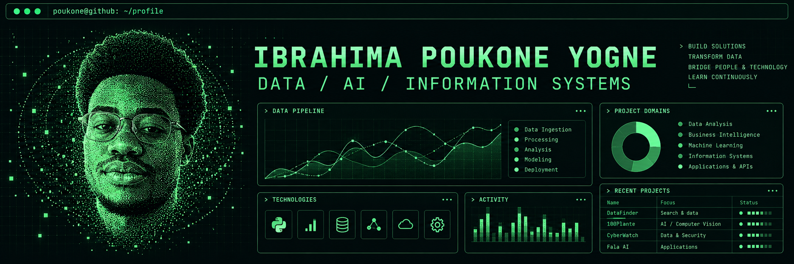

<p align="center">
  
</p>

<p align="center">
  <strong>Analyser les données. Développer des solutions IA. Connecter les systèmes.</strong>
</p>

<p align="center">
  <a href="#profil">Profil</a> · <a href="#projets">Projets</a> · <a href="#competences">Compétences</a> · <a href="#certifications">Certifications</a> · <a href="https://github.com/POUKONE?tab=repositories">Dépôts</a>
</p>

<a id="profil"></a>
## $ whoami

Je suis **Ibrahima Poukone Yogne**, passionné par la **Data, l’intelligence artificielle et les systèmes d’information**. Je développe des applications, des pipelines et des tableaux de bord pour transformer les données en informations utiles et répondre à des besoins concrets.

Mes projets associent analyse, intégration d’API, Machine Learning et développement web. J’accorde une attention particulière à la qualité des données, à l’évaluation des résultats et à la documentation.

```yaml
name: Ibrahima Poukone Yogne
location: France
focus: [Data Analytics, Business Intelligence, Applied AI, SI]
career_goal: Architecte SI, puis manager de projets Data & IA
approach: Comprendre → Construire → Tester → Documenter
```

<a id="projets"></a>
## $ ls ./projects

| Projet | Objectif | Technologies et approches | Liens |
| :--- | :--- | :--- | :--- |
| **DataFinder** | Rechercher, filtrer, comparer et enregistrer des sources de données. | Next.js, API REST, PostgreSQL / Neon | [Code & documentation](https://github.com/POUKONE/DataFinder) |
| **100Plante** | Détecter des maladies sur feuilles de plantes à partir d’images. | Python, MobileNetV2, transfer learning, FastAPI, Next.js | [Code](https://github.com/POUKONE/100Plante) · [Démo](https://100-plante.vercel.app) |
| **CyberWatch** | Collecter et analyser des données de sécurité, calculer un score de risque et détecter des anomalies. Projet collaboratif avec Amsa. | Python, pandas, scikit-learn, Isolation Forest, FastAPI, SQLite, Streamlit | [Code & documentation](https://github.com/POUKONE/projet_data_cybersecurity) |
| **Fala AI** | Préparer les entretiens et suivre les candidatures. | IA générative, coaching et application web | [Dépôt](https://github.com/POUKONE/fala-ai) |

<details>
<summary><strong>100Plante — résultats et périmètre d’évaluation</strong></summary>

- Dataset : **PlantVillage**, 38 classes et 14 espèces.
- Modèle : **MobileNetV2**, par transfer learning.
- Exactitude sur le jeu de test : **96,47 %**.
- F1 macro sur le jeu de test : **95,66 %**.
- Ces résultats décrivent les performances sur PlantVillage ; les conditions réelles de prise de vue peuvent modifier les résultats.

[Consulter le projet et son évaluation](https://github.com/POUKONE/100Plante)

</details>

**Autres réalisations :** BatiPro, un projet ERP pour le BTP, et des tableaux de bord de suivi de performance sous Power BI.

<a id="competences"></a>
## $ cat stack.yml

<p>
  
  
  
  
  
  
</p>

### Langages & données

| Domaine | Technologies |
| :--- | :--- |
| Analyse et programmation | Python : pandas, NumPy, scikit-learn · R |
| Bases de données | SQL · PostgreSQL · MySQL · Oracle |
| Développement web | JavaScript · TypeScript / Next.js · HTML · CSS · PHP |
| Formation à l’ECAM EPMI | MATLAB · Simulink |

### Data, BI & reporting

- **Visualisation :** Power BI, Tableau, Plotly et Excel.
- **Aide à la décision :** tableaux de bord, KPI et restitution à un public non technique.
- **Qualité :** nettoyage, fiabilisation et contrôles qualité des données.
- **Intégration :** pipelines de collecte et de transformation, APIs REST.
- **Stockage :** modélisation relationnelle et migrations de schéma en production.

### IA & Machine Learning

```yaml
machine_learning:
  outils: [scikit-learn]
  modeles: [Régression, Random Forest]
  approches: [Transfer learning]
  evaluation: [Accuracy, F1]
ia_generative:
  llm: LLaMA 3.3-70B — intégration
  transcription: Whisper large-v3
  usages: [Agents IA, applications génératives]
```

### Développement & outils

- **Backend et frontend :** FastAPI, Next.js et API REST.
- **Versionnement et qualité :** Git, GitHub, GitHub Actions (CI) et tests automatisés.
- **Déploiement :** Render et Vercel.
- **Application métier :** ERP, à travers le projet BatiPro.

## $ cat methods.md

- **Scrum et agile :** certification Scrum Fundamentals Certified — SFC™.
- **Gestion de projet :** cadrage des besoins, documentation et suivi de projet.
- **Notions :** processus ITIL et bases de cybersécurité avec Python.

<a id="certifications"></a>
## $ ls ./certifications

| Domaine | Certification / Programme |
| :--- | :--- |
| Data Science | BCG Data Science |
| Data Science | British Airways Data Science |
| Data | IBM Getting Started with Data |
| Data Visualisation | Tata Data Visualisation |
| IA générative | BCG GenAI |
| Bases de données | Oracle Database Explorer — 95 % |
| Cybersécurité | Cisco Introduction to Cybersecurity |
| Scrum | Scrum Fundamentals Certified — SFC™ |

## $ cat languages.txt

**Français** — langue maternelle · **Anglais** · **Allemand**

## $ cat workflow.md

```text
01  Comprendre le besoin métier et définir les critères de réussite.
02  Collecter, nettoyer et contrôler les données.
03  Construire l’analyse, le modèle ou l’application.
04  Tester et évaluer les résultats.
05  Déployer, documenter et améliorer.
```

---

<p align="center">
  <code>Des données aux décisions. Des idées aux applications.</code><br /><br />
  <a href="https://github.com/POUKONE?tab=repositories">Explorer mes dépôts</a> ·
  <a href="https://github.com/POUKONE/portfolio_3D">Portfolio — code source</a>
</p>
